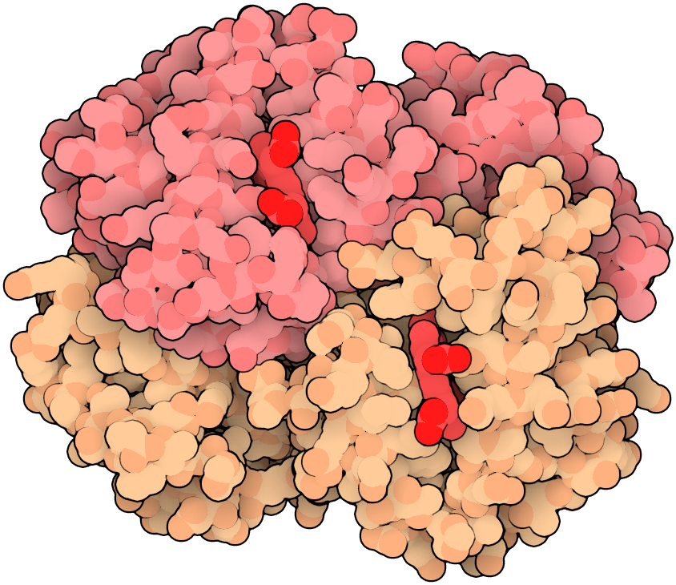

# goodsell-oxillustrate-rs

Render molecular structures as Goodsell-style illustrations for teaching and scientific communication. A native Rust command-line tool and library turn PDB, mmCIF, or PDBML coordinates into shaded, outlined PNG images.

Space-filling atoms, soft shadows, and selective black outlines make molecular shapes and
boundaries readable. The hemoglobin example below colors protein chain pairs pink and peach
and highlights their heme groups in red.

<!-- screenshots:begin (managed by screenshot-docs) -->

<!-- screenshots:end -->

## From coordinates to illustration

- Read local PDB, PDBx/mmCIF, and PDBML XML, including gzip-compressed files.
- Select a deposited model or a biological assembly without losing author and label identifiers.
- Start with warm chain colors, hidden water and hydrogen, and automatic orthographic framing.
- Adjust appearance in JSON: ordered atom rules, conical shadows, fog, and three outline passes.
- Use the same loading, scene preparation, and rendering pipeline from Rust.

## Quick start

Install Rust 1.99.1 or newer and run these commands from the repository root. The renderer needs
no Python, Fortran, GPU, or local reference repositories.

```bash
cargo build --release --locked
mkdir -p output
./target/release/illustrate examples/sample.pdb --output output/sample.png
```

The example writes an 800 x 800 PNG from original synthetic four-atom geometry. It requires no
coordinate download; these atoms demonstrate rendering rather than a biological structure.
See [docs/INSTALL.md](docs/INSTALL.md) for setup and installation verification.

For your own structure, start with automatic framing and an 800 x 800 image:

```bash
./target/release/illustrate your_structure.cif --output output/structure.png
```

## Render hemoglobin

Reproduce the illustration above with public RCSB coordinates and the included scene file.
This example also needs `curl` and network access for the coordinate download:

```bash
mkdir -p output
curl --fail --location https://files.rcsb.org/download/2HHB.cif --output output/2hhb.cif
./target/release/illustrate output/2hhb.cif --scene examples/hemoglobin.json \
  --output output/hemoglobin.png
```

The result is a 922 x 750 PNG. [examples/hemoglobin.json](examples/hemoglobin.json) sets the
view, atom colors, radii, and outline settings. Edit a scene file to change appearance, or use
`--width` and `--height` to override its image dimensions.
See [docs/USAGE.md](docs/USAGE.md) for scene fields, model and assembly selection, and the Rust API.

## Use and extend

- [docs/INSTALL.md](docs/INSTALL.md): build the native executable and library.
- [docs/USAGE.md](docs/USAGE.md): render structures and change scene settings.
- [docs/CODE_ARCHITECTURE.md](docs/CODE_ARCHITECTURE.md): follow the data and rendering passes.
- [docs/FILE_STRUCTURE.md](docs/FILE_STRUCTURE.md): find code, examples, tests, and evidence.

## Method and verification

Independent visual review accepts the checked reference scenes, and all 19 reference/native
silhouette masks match. Clean-source macOS arm64 and emulated Linux x86_64 build, test,
installation, and rendering checks pass. Physical x86_64 execution and remote CI have not been
tested; platform details are in [docs/INSTALL.md](docs/INSTALL.md).

- [docs/REFERENCE_SPEC.md](docs/REFERENCE_SPEC.md): reference mathematics and deliberate corrections.
- [docs/CHANGELOG.md](docs/CHANGELOG.md): implementation and verification history.
- [docs/active_plans/reports/goodsell_fidelity.md](docs/active_plans/reports/goodsell_fidelity.md):
  measured source comparisons and protein/DNA/virus assembly rendering.
- [docs/active_plans/reports/goodsell_native_validation.md](docs/active_plans/reports/goodsell_native_validation.md):
  clean-source installation, target execution, and CI evidence boundaries.

## Scope and attribution

This is a synchronous, CPU-based sphere renderer with an orthographic camera. It produces PNG,
not meshes or animations. PDBx/mmCIF support targets macromolecular coordinate files with one data
block; save frames and small-molecule CIF dictionaries are outside the supported input scope.

The rendering method follows Goodsell DS, Autin L, Olson AJ (2019),
[*Illustrate: Software for Biomolecular Illustration*](https://doi.org/10.1016/j.str.2019.08.011).
This is a new Rust implementation; the legacy code was used for comparison and removed.
Developer verification tools can fetch a pinned reference temporarily. Provenance and reference
corrections are in
[docs/REFERENCE_SPEC.md](docs/REFERENCE_SPEC.md).

## License

Source code: [LICENSE.AGPL-3.0](LICENSE.AGPL-3.0).

Documentation and other non-code materials: [LICENSE.CC-BY-4.0](LICENSE.CC-BY-4.0).
