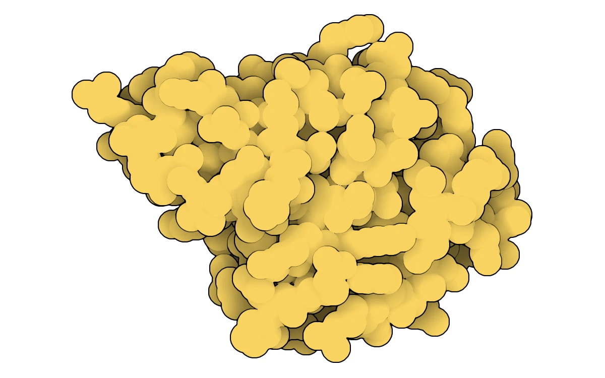
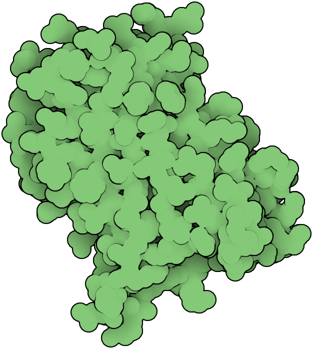
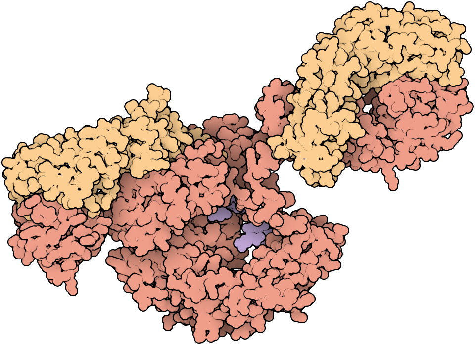
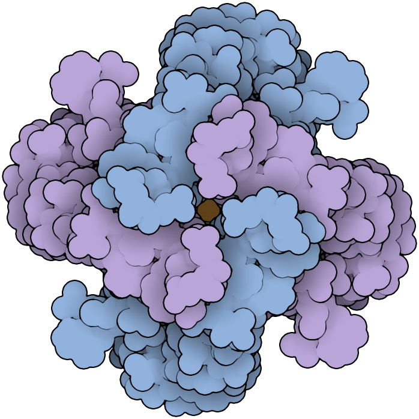
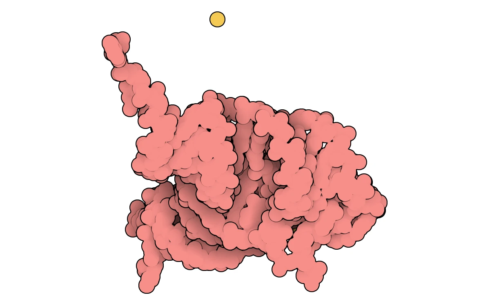
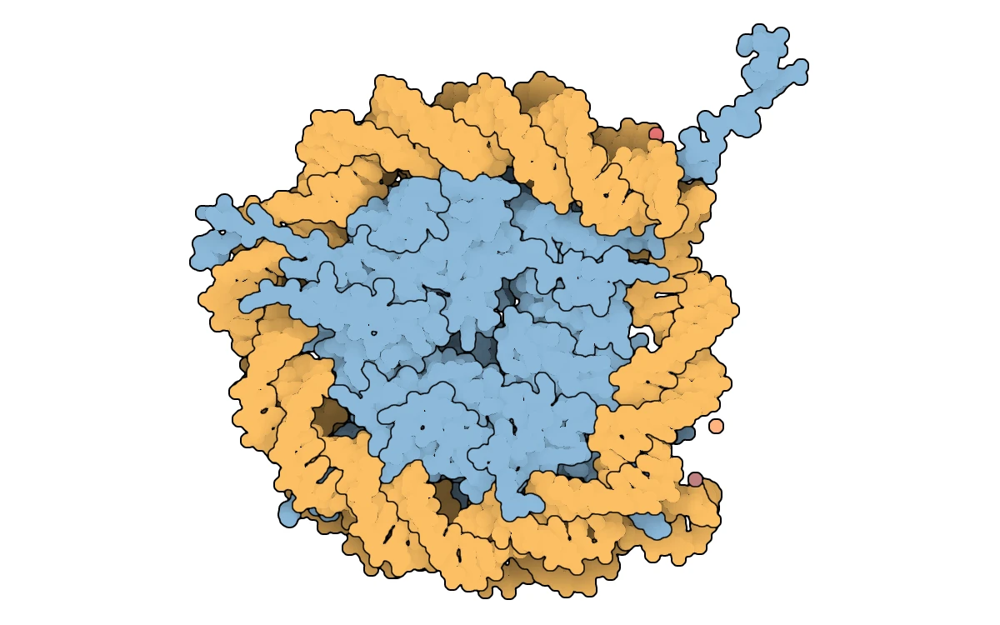
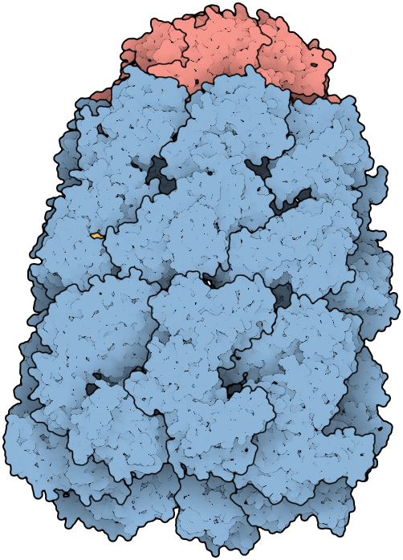
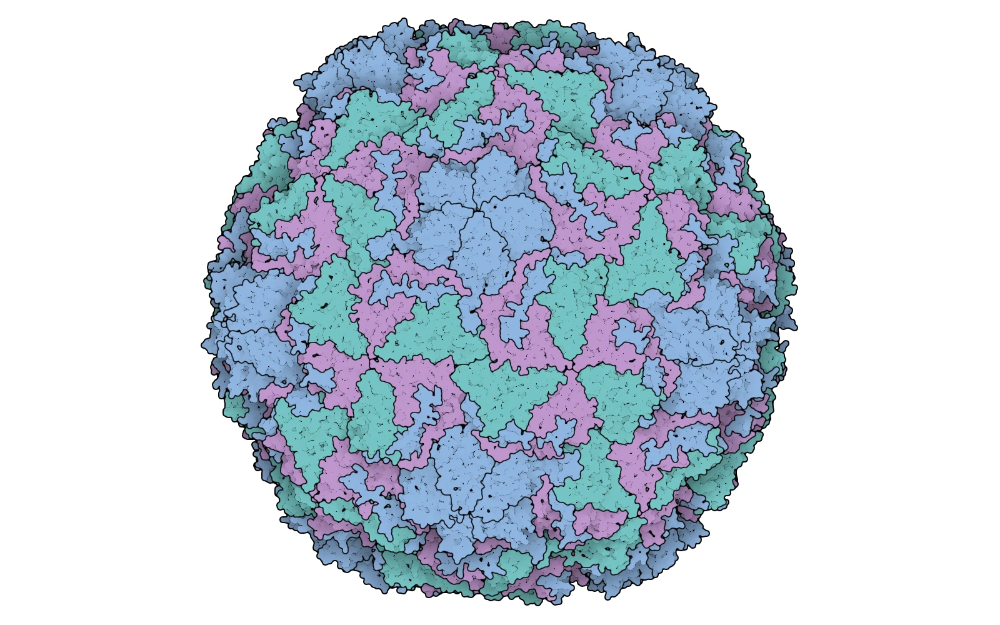

# Molecular gallery

Choose a molecule, copy its command, and make a figure for your own slides or report.
These new renders take their subjects and restrained colors from David S. Goodsell and RCSB PDB's
[Molecular Machinery posters from 2002 and 2014](https://pdb101.rcsb.org/learn/flyers-posters-and-calendars/poster/molecular-machinery-a-tour-of-the-protein-data-bank).

Each image is fitted independently; the molecules are **not shown at a common physical scale**.
Colors identify chains or molecular components, as described below. Water and hydrogen are hidden.
The renderer trims unused canvas space, leaving three pixels of padding. Native exports default
to 300 dpi; change this with `--dpi`. Add any page margins afterward.
Use the commands to generate print images; the previews here are native lossless WebPs with alpha.

Follow [INSTALL.md](INSTALL.md) once, then run commands from the repository root. Create an
output folder before rendering:

```bash
mkdir -p output_gallery
```

## Lysozyme

A compact enzyme in the posters' warm yellow palette. This is human lysozyme,
[PDB 1LZ1](https://www.rcsb.org/structure/1LZ1), shown in both posters.



```bash
./target/release/illustrate --pdb 1lz1 --scene examples/gallery/lysozyme.json \
  --output output_gallery/lysozyme.png
```

## Green fluorescent protein

The green barrel-shaped protein from the 2014 poster. The scene shows chain A of
[PDB 1GFL](https://www.rcsb.org/structure/1GFL), selecting one protein from the two deposited chains.



```bash
./target/release/illustrate --pdb 1gfl --scene examples/gallery/gfp.json \
  --output output_gallery/gfp.png
```

## Antibody

An intact IgG antibody from both posters, [PDB 1IGT](https://www.rcsb.org/structure/1IGT).
Heavy chains are coral, light chains are gold, and attached sugars are lavender.



```bash
./target/release/illustrate --pdb 1igt --scene examples/gallery/antibody.json \
  --output output_gallery/antibody.png
```

## Potassium channel

The KcsA channel from the 2002 poster, [PDB 1BL8](https://www.rcsb.org/structure/1BL8).
Assembly 1 contains four protein subunits. Alternating blue and lavender colors outline their
arrangement around the central pore; potassium ions are gold.



```bash
./target/release/illustrate --pdb 1bl8 --scene examples/gallery/potassium_channel.json \
  --output output_gallery/potassium_channel.png
```

## Transfer RNA

Folded RNA adds a different molecular shape to the collection. Yeast phenylalanine tRNA,
[PDB 4TNA](https://www.rcsb.org/structure/4TNA), appears in both posters. RNA is coral;
magnesium ions are gold.



```bash
./target/release/illustrate --pdb 4tna --scene examples/gallery/trna.json \
  --output output_gallery/trna.png
```

## Nucleosome

Gold DNA wraps around blue histone proteins in [PDB 1AOI](https://www.rcsb.org/structure/1AOI).
This assembly from both posters makes the relationship between DNA and protein easy to follow.



```bash
./target/release/illustrate --pdb 1aoi --scene examples/gallery/nucleosome.json \
  --output output_gallery/nucleosome.png
```

## GroEL and GroES

A capped protein-folding cage from both posters, [PDB 1AON](https://www.rcsb.org/structure/1AON).
The GroEL barrel is blue and its GroES cap is coral. The scene uses the complete assembly 1.



```bash
./target/release/illustrate --pdb 1aon --scene examples/gallery/groel_groes.json \
  --output output_gallery/groel_groes.png
```

## Rhinovirus

The complete rhinovirus 14 capsid from both posters,
[PDB 4RHV](https://www.rcsb.org/structure/4RHV). Assembly 1 expands the deposited coordinates into
the whole shell. Blue, teal, and violet distinguish the exposed coat proteins; VP4 is pink.



```bash
./target/release/illustrate --pdb 4rhv --scene examples/gallery/rhinovirus.json \
  --output output_gallery/rhinovirus.png
```

## Make these figures yours

The scene files in [examples/gallery/](../examples/gallery/) contain the colors, orientations,
and assembly choices. All eight inherit a transparent background, so the figures blend into
light or dark pages and slides. Choose native WebP simply by changing the output extension:

```bash
./target/release/illustrate --pdb 1aoi --scene examples/gallery/nucleosome.json \
  --output output_gallery/nucleosome.webp
```

Use `--width` and `--height` for a different image size. More options and scene-file guidance
are in [USAGE.md](USAGE.md).
The nucleosome, GroEL/GroES, and rhinovirus scenes use a smaller contour neighborhood
(`"outlines": {"kernel": 3}`) so dense atomic detail stays lightly outlined at these image sizes.

To refresh all gallery images, run [devel/render_gallery.sh](../devel/render_gallery.sh).
The refresh helper uses the native downloader and renderer to write lossless WebPs with alpha
directly. It requires no image converter. Use the individual PNG commands for print exports.

## Credits

The molecular selection and palette take inspiration from the 2002 and 2014
*Molecular Machinery: A Tour of the Protein Data Bank* posters by David S. Goodsell and RCSB PDB.
The [PDB-101 poster page](https://pdb101.rcsb.org/learn/flyers-posters-and-calendars/poster/molecular-machinery-a-tour-of-the-protein-data-bank)
provides the original artwork. Gallery images are newly generated from the linked PDB coordinates
using this repository's renderer and scene files.
