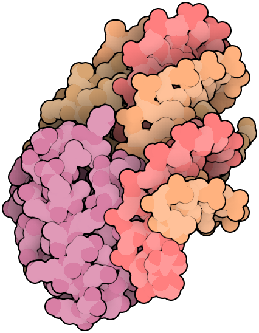
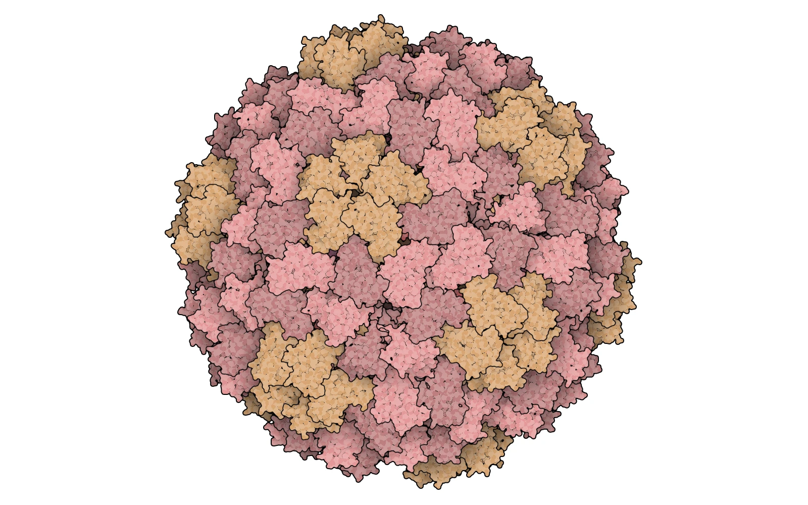
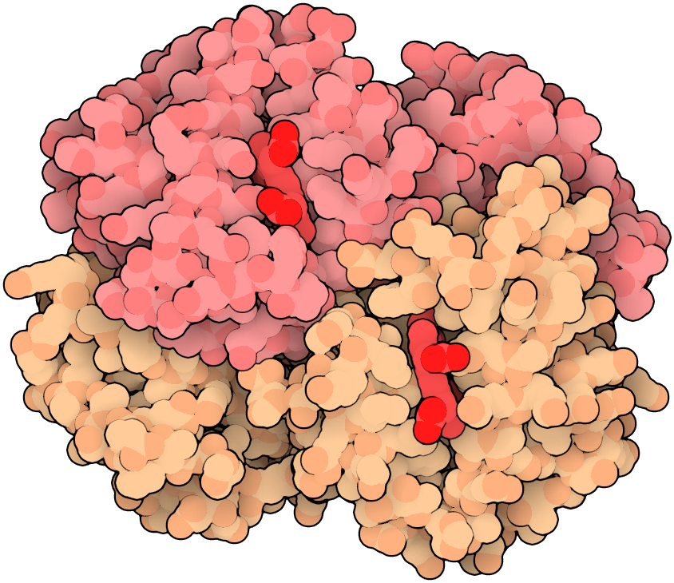

# Usage

Render a local molecular structure or an RCSB entry to PNG or WebP with `illustrate`.
Build the executable first using [INSTALL.md](INSTALL.md). Commands below run from the repo root.

## Quick start

```bash
mkdir -p output
./target/release/illustrate examples/sample.pdb --output output/sample.png
```

The original synthetic four-atom example writes an 800 x 800 image with automatic framing and warm chain colors,
conical shadows, and contour, subunit, and residue outlines. Its background is transparent.
Native defaults hide H, D, and water
and retain other hetero atoms. The first model in source order is selected.

Replace the sample with your local structure path, or use the public hemoglobin example:

```bash
./target/release/illustrate --pdb 2hhb --output output/hemoglobin.png \
  --scene examples/hemoglobin.json
```

[hemoglobin.json](../examples/hemoglobin.json) specifies a 922 x 750 image, source-style
orientation and ordered pink/peach protein and red-heme rules.

## Transparency and output format

The output filename selects `.png` or `.webp`, case-insensitively. WebP is encoded natively and
losslessly; both formats preserve alpha. New scenes have a transparent background by default.
Use `--background white` or `--background black` for an opaque image, or
`--background transparent` to override an RGB background in a scene file.

```bash
./target/release/illustrate --pdb 1lmb --output output/protein.webp
./target/release/illustrate --pdb 1lmb --background white --output output/protein_white.png
```

In JSON, `"background": null` means transparent; an RGB triple such as `[1,1,1]` means opaque.
Existing RGB-background scene files keep their appearance. Atom surfaces remain opaque;
outline-only pixels carry black with fractional alpha, avoiding a white fringe when composited.
Depth fog still uses the scene's explicit fog color; transparency does not recolor molecular atoms.

## More molecular examples

These images were rendered by the same `illustrate` program. The first shows lambda repressor
bound to DNA (PDB 1LMB), with colors distinguishing the chains. The second shows the complete
biological assembly 1 of cowpea chlorotic mottle virus (PDB 1CWP). The last image shows the same
transparent hemoglobin render composited over light and dark slide backgrounds.

<!-- screenshots:begin (managed by screenshot-docs) -->



<!-- screenshots:end -->

Download the coordinates and make the images:

```bash
mkdir -p output
./target/release/illustrate --pdb 1lmb --background white --output output/lambda_dna.png \
  --width 960 --height 600
./target/release/illustrate --pdb 1cwp --assembly 1 --background white --output output/cowpea_capsid.png \
  --width 1600 --height 1000
```

The images are 960 x 600 and 1600 x 1000 PNGs, respectively. The virus example uses
`--assembly 1` to build the complete capsid from the deposited coordinates and assembly operations.

## Command-line options

```text
illustrate [INPUT | --pdb ID] --output <OUTPUT> [OPTIONS]
```

| Option | Behavior |
| --- | --- |
| `--pdb` | Download one RCSB entry by case-insensitive accession; replaces local INPUT |
| `--output`, `-o` | Required destination `.png` or `.webp` filename |
| `--background` | Override JSON with `transparent`, `white`, or `black` |
| `--scene` | Read partial scene settings from a JSON file |
| `--width`, `--height` | Override image dimensions in pixels |
| `--model` | Select a positive deposited model number |
| `--assembly` | Select an assembly ID defined by the input |
| `--help`, `--version` | Show command help or package version |

Explicit flags take precedence over JSON settings. Deposited coordinates are the default;
assembly selection requires metadata in the input. For example:

```bash
./target/release/illustrate --pdb 2hhb --output output/assembly.png \
  --assembly 1 --width 1000 --height 1000
```

## Scene settings

JSON may provide only changed fields; unknown keys are errors. For example, save this as a scene
file and pass its path with `--scene`:

```json
{
  "width": 1000,
  "height": 800,
  "orientation": [0, 0, 90],
  "fog": {"front": 1, "back": 0.5}
}
```

Colors are RGB triples in [0,1]. `orientation` uses source-compatible x/y/z degrees, applied Z,
then Y, then X. `framing.scale` sets pixels per Angstrom; absent scale fits sphere bounds with
30-pixel margins. `translation` follows rotation and centering. Source x points down image rows,
y points right along columns, and z points toward the viewer.

`atom_rules` use first-match selection by element, chain, residue, atom name, or kind. Chain and
residue-number selectors default to the author namespace; use `"namespace": "label"` explicitly
for label IDs. A matching rule changes only supplied appearance fields; `"omit": false` can restore
water or hydrogen. Full field definitions and defaults are documented on `SceneSettings` in
[src/settings.rs](../src/settings.rs) and in generated Rust API documentation.

## Rust API

```rust,no_run
use oxillustrate::{SceneSettings, load_structure, prepare_scene, render};

fn main() -> Result<(), oxillustrate::Error> {
    let structure = load_structure("structure.cif")?;
    let scene = prepare_scene(&structure, &SceneSettings::default())?;
    render(&scene)?.save("structure.webp")?;
    Ok(())
}
```

Replace `load_structure("structure.cif")` with `oxillustrate::load_pdb("1lmb")` to download by ID.
`RenderedImage.pixels` holds RGB bytes; its optional `alpha` vector holds one straight-alpha byte
per pixel. `save` selects the encoder by extension; `save_png` and `save_webp` select it explicitly.
Run `cargo doc --no-deps --locked --open` to browse the public API. `Scene` owns prepared spheres;
rendering does not reread the input. Diagnostics are retained on the prepared scene and printed
by the CLI.

## Inputs, output, and limits

`--pdb` uses RCSB's HTTPS mmCIF service, preserving chain IDs and assembly definitions. It accepts
four-character IDs such as `1lmb` and extended IDs such as `pdb_00001lmb`. The response is parsed
in memory with a 60-second timeout and 1 GiB limit; no coordinate cache is written. A download
failure leaves an existing image untouched. Local-file rendering needs no network connection.
Service details: [RCSB file downloads](https://www.rcsb.org/docs/programmatic-access/file-download-services).

Input supports PDB/ENT, macromolecular PDBx/mmCIF, and PDBML XML, optionally gzip compressed.
CIF accepts one data block and no save frames. Alternate locations use highest mean occupancy
per residue, lexical ties, and retained shared blank-location atoms.

Create the output parent directory first. Saving uses a sibling temporary file followed by rename;
an existing destination is replaced only after successful encoding and flushing. The CLI rejects
an output path that resolves to its structure or JSON input. Errors print to stderr and exit nonzero.

Limits are 1 GiB decompressed input, 16,777,216 image pixels, 1,000,000 expanded assembly operations,
and 20,000,000 assembly atom references. Unsupported selections, empty visible scenes, and invalid
numeric settings return errors. These limits bound work; they do not guarantee sufficient memory
for every permitted input.

WebP additionally limits each image dimension to 16384 pixels. An unsupported format or size
returns an error and preserves an existing destination file.
